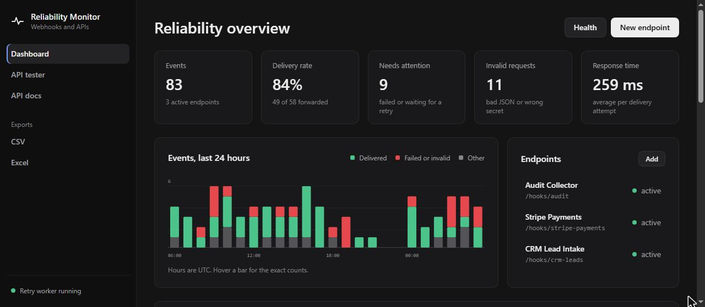
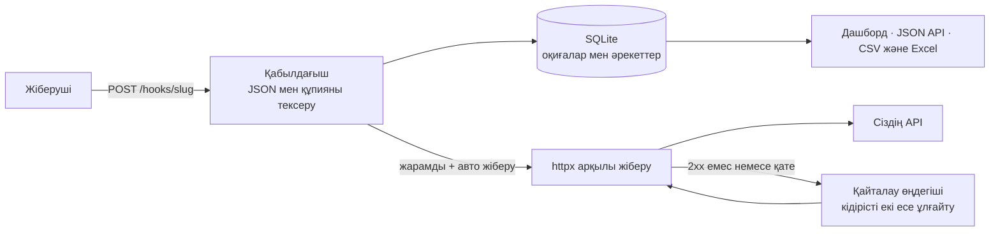
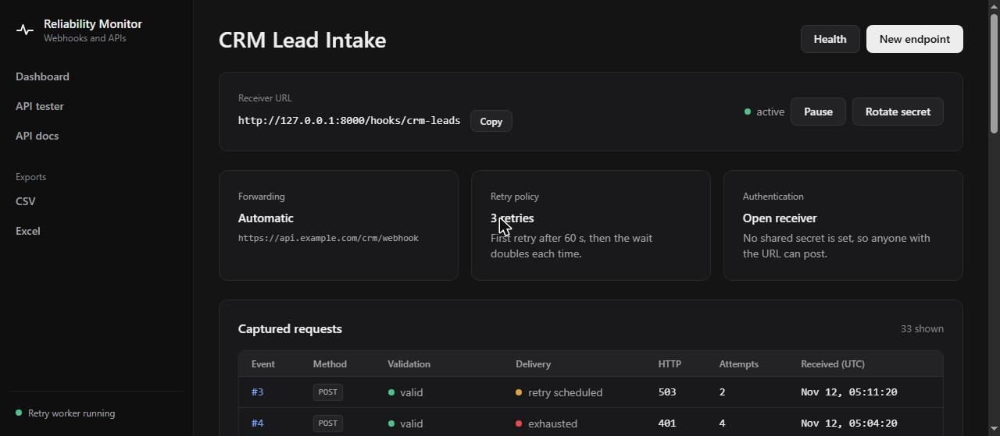
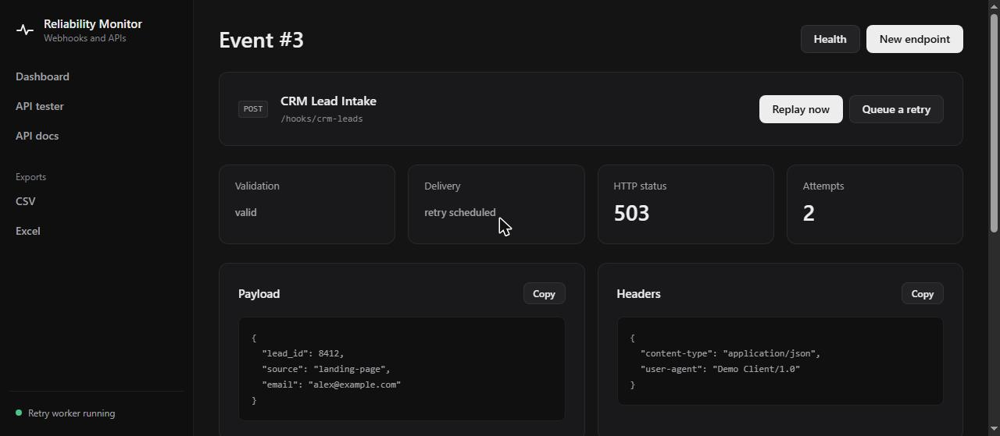
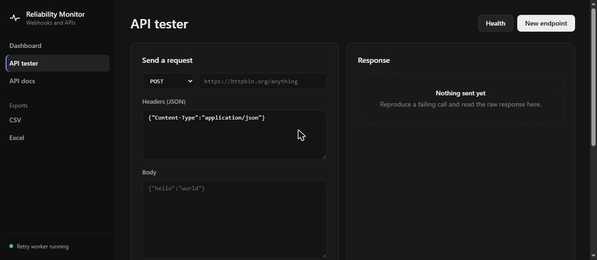

<div align="center">

# 📡 API & Webhook Reliability Monitor

**Вебхуктарды қабылдайды, тексереді, жібереді, сәтсіз жеткізулерді қайталайды және не бұзылып жатқанын бірден көрсетеді.**

[](https://github.com/artyom129/api-webhook-reliability-monitor/actions/workflows/tests.yml)


**🌐 Тіл:** [English](README.md) · [Русский](README.ru.md) · **Қазақша**



</div>

---

## 📌 Не үшін қажет

Вебхук интеграциялары үнсіз бұзылады: жіберуші жарамсыз JSON жібереді, құпия сөздің мерзімі аяқталады, қабылдаушы API бес минут нашар жұмыс істейді, ал клиент тапсырысы қайда екенін сұрамайынша ешкім білмейді. Бұл жоба ортада тұрады. Ол әр сұрауды толық сақтайды, оның дұрыс-бұрыстығын айтады, оны сіздің API-ға жібереді, API қолжетімсіз болса жеткізуді қайталайды және кез келген оқиғаны кейін қайта жіберуге мүмкіндік береді, бастапқы қызметтен оны қайта жіберуін сұраудың қажеті жоқ.

## ✨ Не істейді

| | Мүмкіндік |
|---|---|
| 🔗 | **Қабылдағыш мекенжайлар.** Endpoint жасап, GET, POST, PUT, PATCH және DELETE қабылдайтын `/hooks/{slug}` URL-ын алыңыз |
| 🗃️ | **Толық сақтау.** Әр сұрау үшін әдіс, тақырыптар, сұрау жолы, мазмұн түрі, бастапқы дене және талданған JSON сақталады |
| ✅ | **Тексеру.** JSON денесінің талданатынын және `X-Webhook-Secret` тақырыбының сәйкес келетінін тексереді. Жарамсыз сұраулар сақталады, белгіленеді және ешқашан жіберілмейді |
| 🔐 | **Құпияны өңдеу.** Ортақ құпия тексеріледі, содан кейін жасырылады. Ол оқиғамен бірге сақталмайды, интерфейсте көрсетілмейді және нысана серверге жіберілмейді |
| ➡️ | **Жіберу.** Бастапқы тақырыптарды, сұрау параметрлерін және денені нысана URL-ға жібереді және әр әрекеттің күйін, жауабын және ұзақтығын жазады |
| 🔁 | **Үзіліспен қайталау.** Сәтсіз жеткізу әр жолы екі есе ұлғаятын кідіріспен endpoint шегі біткенше қайталанады |
| ▶️ | **Қайта жіберу.** Сақталған кез келген оқиғаны бір басумен қайта жіберіңіз немесе бірден қайталауды кезекке қойыңыз |
| 📈 | **Дашборд.** Жеткізілген үлесі, назар аударуды қажет ететін оқиғалар, жарамсыз сұраулар, орташа жауап уақыты және соңғы 24 сағаттың сағаттық графигі |
| 🔎 | **Іздеу API.** `/api/events` endpoint, тексеру күйі, жеткізу күйі және дене не қате мәтіні бойынша сүзеді |
| 🧪 | **API тестері.** Браузерден кез келген REST сұрауын жіберіңіз, шақырулар тарихы сақталады |
| 📥 | **Экспорт.** CSV және пішімделген Excel. Кесте формуласы сияқты басталатын вебхук денелері залалсыздандырылады |
| 🩺 | **Күйді тексеру.** `/health` дерекқорды тексереді және қайталау өңдегішінің жұмыс істеп тұрғанын хабарлайды |
| 🌗 | **Ашық және қараңғы тақырып.** Интерфейс жүйе тақырыбын ұстанады |

## 🔄 Сұрау қалай жүреді



## 🖼️ Экрандар

| Endpoint | Оқиға |
|---|---|
|  |  |



## 🚀 Жылдам бастау

```bash
git clone https://github.com/artyom129/api-webhook-reliability-monitor.git
cd api-webhook-reliability-monitor
python -m venv .venv
```

Ортаны іске қосыңыз:

```bash
# Windows
.venv\Scripts\activate

# macOS / Linux
source .venv/bin/activate
```

Тәуелділіктерді орнатып, серверді іске қосыңыз:

```bash
pip install -r requirements.txt
python run.py
```

Содан кейін ашыңыз:

- Дашборд: http://localhost:8000
- API құжаттамасы (Swagger): http://localhost:8000/docs
- Күйді тексеру: http://localhost:8000/health

`run.py` тек `127.0.0.1` мекенжайын тыңдайды. Басқа құрылғыдан кіру үшін `HOST=0.0.0.0` орнатыңыз, бірақ алдымен қауіпсіздік бөлімін оқыңыз.

### Демо-деректер

```bash
python seed_demo.py
python run.py
```

Скрипт үш endpoint және соңғы тәулікке таралған шамамен 80 оқиға жасайды, олардың ішінде ақаулар, жарамсыз сұраулар және жоспарланған қайталау бар. Ол деректері бар дерекқорға тимейді. Оны ауыстыру үшін `python seed_demo.py --reset` іске қосыңыз.

### Docker

```bash
docker compose up --build
```

SQLite дерекқоры Docker томында сақталады.

## 🧭 Жұмыс мысалы

1. Нысана URL мен құпиясы бар `Stripe Payments` (slug `stripe-payments`) endpoint-ін жасаңыз.
2. Сұрау жіберіңіз:

```bash
curl -X POST http://localhost:8000/hooks/stripe-payments \
  -H "Content-Type: application/json" \
  -H "X-Webhook-Secret: your-secret" \
  -d '{"type":"invoice.paid","data":{"id":"in_123"}}'
```

3. Дашбордта оқиғаны ашып, тексеру және жеткізу күйін қараңыз.
4. Егер API қолжетімсіз болса, оны түзетіп, **Replay now** батырмасын басыңыз.
5. Оқиғалар тарихын CSV немесе Excel-ге шығарыңыз.

## 🔁 Қайталаулар және жеткізу күйлері

`max_retries` бірінші әрекеттен **кейінгі** қайталауларды санайды, сондықтан `3` жалпы төрт әрекетке дейін дегенді білдіреді. Әр қайталау алдындағы күту уақыты екі есе ұлғаяды. Негізгі кідіріс 30 секунд болса, қайталаулар 30, 60 және 120 секундтан кейін жүреді.

| Күй | Мағынасы |
|---|---|
| `not_configured` | Endpoint-те нысана URL жоқ немесе авто жіберу өшірулі |
| `queued` | Қабылданды және жақын арада жіберіледі |
| `skipped` | Сұрау тексеруден өтпеді, сондықтан сақталды, бірақ жіберілмеді |
| `delivered` | Нысана сервер 2xx күйімен жауап берді |
| `retry_scheduled` | Соңғы әрекет сәтсіз болды, келесісі жоспарланды |
| `exhausted` | Рұқсат етілген барлық қайталау сәтсіз болды |

Жеткізу endpoint белсенді, авто жіберу қосулы, сұрау тексеруден өткен және қайталаулар қалған жағдайда ғана қайталанады. Әр әрекет аудит үшін сақталады.

## 🌐 Маршруттар

| Маршрут | Мақсаты |
|---|---|
| `/` | Дашборд |
| `/hooks/{slug}` | Ашық вебхук қабылдағышы |
| `/endpoints/{id}` | Endpoint баптаулары және сақталған сұраулар |
| `/events/{id}` | Дене, тақырыптар, жауап және жеткізу әрекеттері |
| `/api-tester` | REST сұрауларының қолмен тестері |
| `/api/stats` | Дашборд сандары JSON түрінде |
| `/api/events` | Оқиғалар JSON түрінде. Сүзгілер: `endpoint`, `validation_status`, `forwarding_status`, `q`, `limit` |
| `/exports/events.csv`, `/exports/events.xlsx` | Оқиғалар тарихының экспорты |
| `/health` | Дерекқор мен өңдегіш күйі (дерекқор қолжетімсіз болса HTTP 503) |
| `/docs` | Swagger құжаттамасы |

## ⚙️ Баптау

Айнымалыларды ортада орнатыңыз (үлгі `.env.example` файлында).

| Айнымалы | Мағынасы | Әдепкі мәні |
|---|---|---|
| `DATABASE_URL` | SQLAlchemy дерекқор URL-ы | `sqlite:///./data/monitor.db` |
| `RETRY_POLL_SECONDS` | Өңдегіш мезгілі келген қайталауларды қаншалықты жиі іздейді | `5` |
| `REQUEST_TIMEOUT_SECONDS` | Жіберілетін сұраулар мен API тестерінің күту уақыты | `15` |
| `MAX_BODY_BYTES` | Бұдан үлкен вебхук денелері HTTP 413 арқылы қабылданбайды | `1000000` |
| `APP_NAME` | Бет тақырыптарындағы атау | API & Webhook Reliability Monitor |
| `HOST`, `PORT`, `RELOAD` | Тек `run.py` үшін | `127.0.0.1`, `8000`, `1` |

<details>
<summary>🐛 Осы нұсқада табылып, түзетілген мәселелер</summary>

<br>

- **`max_retries=1` қайталау жасамайтын.** Шек әрекеттердің жалпы санымен салыстырылатын, сондықтан бір қайталау нөл болып шығатын. Енді ол бірінші әрекеттен кейінгі қайталауларды санайды.
- **Ортақ құпия нысана серверге жіберілетін.** Барлық тақырыптар, соның ішінде `X-Webhook-Secret`, көшірілетін, сондықтан қабылдаушы қызмет монитордың өз құпиясын біліп қоятын. Ол оқиғамен бірге сақталып, оның бетінде де көрсетілетін. Енді ол сақтау алдында жасырылады және ешқашан жіберілмейді.
- **Экспорттағы формула енгізу.** `=HYPERLINK(...)` сияқты вебхук денесі Excel немесе CSV ашылғанда жұмыс істейтін формулаға айналатын. `=`, `+`, `-` немесе `@` белгісінен басталатын ұяшықтар енді мәтін ретінде жазылады.
- **Жарамсыз сұраулар мәңгі `queued` күйінде қалатын.** Олар жіберуді күтіп тұр деп белгіленетін, бірақ жіберілмейтін. Енді оларға `skipped` қойылады.
- **Сұрау көлемінің шегі болмады.** Бір үлкен дене тікелей дерекқорға түсетін. Әдепкі шек 1 МБ.
- **Бүйір панельде әрдайым «Retry worker active» деп жазылатын.** Енді өңдегіштің нақты күйі көрсетіледі.
- **`/health` тұрақты мән қайтаратын.** Енді ол дерекқорды тексереді.
- **«Іздестірілетін» тарихта іздеу болмады.** `/api/events` енді endpoint, күй және мәтін бойынша сүзеді. Мәтін іздеуі `%` пен `_` белгілерін қарапайым таңба деп санайды.
- **`seed_demo.py` дерекқорды сұрамай өшіретін**, ал **`run.py` барлық желі интерфейстерін автоқайта жүктеумен тыңдайтын.** Енді скриптке `--reset` қажет, ал сервер әдепкіде тек localhost-ты тыңдайды.
- **README жоқ `.env.example` файлына сілтеме жасайтын.** Енді файл бар.
- **Кейбір дисктерде тесттерді дайындау баяу болды.** Windows-та SQLite файлын жасау бір тестке шамамен 2,5 секунд алатын, жиынтық екі минутқа жуық жүретін. Енді тесттер жадтағы дерекқорды қолданады және шамамен 3 секундта аяқталады.

</details>

## 🧪 Тесттер

```bash
python -m pytest
```

44 тест, желісіз. HTTP клиенті алмастырғышпен ауыстырылған, сондықтан тесттер нысана серверге нақты не кететінін тексереді. Олар сұрауларды тексеруді, құпиямен жұмысты, жіберуді, қайталау кестесін, қайта жіберуді, кідіртуді және құпияны ауыстыруды, API тестерін, сүзгілер мен іздеуді, статистиканы, экспортты (формуладан қорғауды қоса), қате беттерін және сағаттық график деректерін қамтиды. CI оларды Python 3.11 және 3.12 нұсқаларында іске қосады.

## 📂 Жоба құрылымы

```text
app/
├── main.py          # маршруттар және қосымша фабрикасы
├── models.py        # SQLAlchemy модельдері
├── services.py      # жіберу, қайталау, статистика, іздеу
├── config.py        # ортадан алынатын баптаулар
├── database.py      # қозғалтқыш және сессиялар
├── templates/       # беттер
└── static/          # CSS және JavaScript
tests/
docs/screenshots/
seed_demo.py         # демо-деректер
run.py               # әзірлеу сервері
Dockerfile
docker-compose.yml
```

## 🔒 Қауіпсіздік туралы

Бұл портфолио жобасы, ол өз компьютеріңізде немесе жабық желі ішінде жұмыс істеуге арналған. Оны сыртқа ашпас бұрын:

- Дашбордта **кіру жүйесі жоқ**. Оны аутентификацияның немесе VPN-нің артына қойыңыз.
- Құпиялар дерекқорда ашық мәтінмен сақталады.
- Жіберу және API тестері сіз көрсеткен кез келген мекенжайға, соның ішінде желіңіздің ішіндегі мекенжайларға да барады.
- HTTPS, сұраулар жиілігін шектеуді және PostgreSQL сияқты өндірістік дерекқорды қосыңыз.

## 🧰 Технологиялар

Python · FastAPI · SQLAlchemy 2 · HTTPX · Jinja2 · SQLite · pandas · openpyxl · Uvicorn · pytest · Docker · GitHub Actions

---

<div align="center">

*Авторы: [Artyom Koncha](https://github.com/artyom129). MIT лицензиясы.*

</div>
