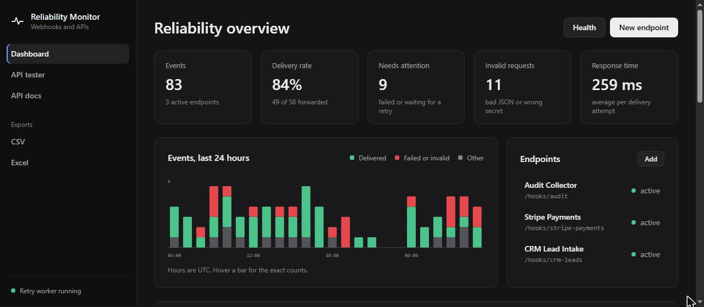
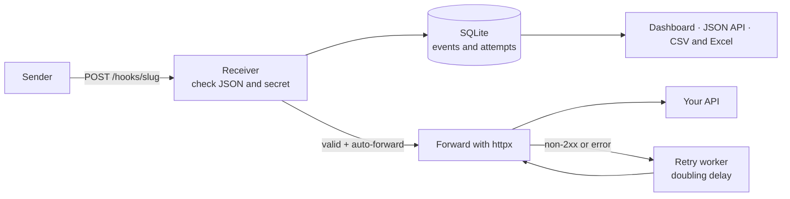
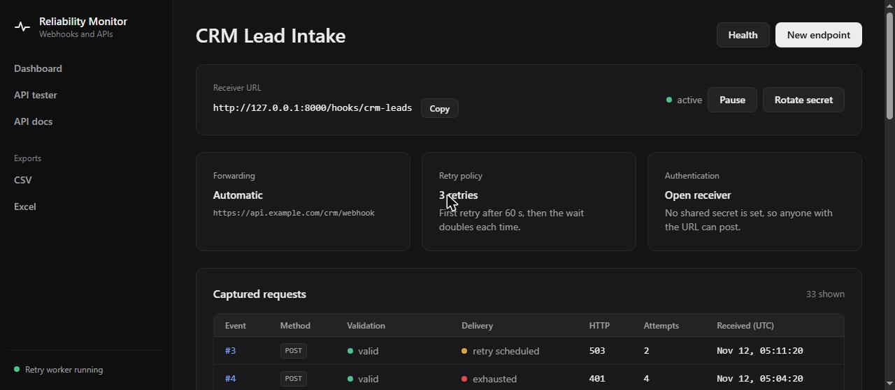
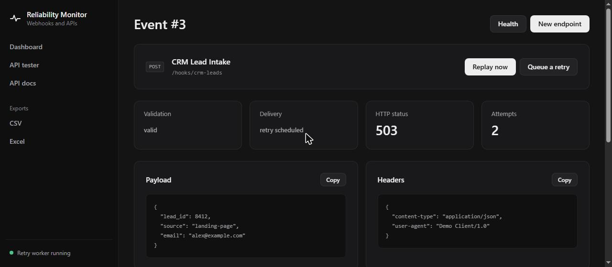
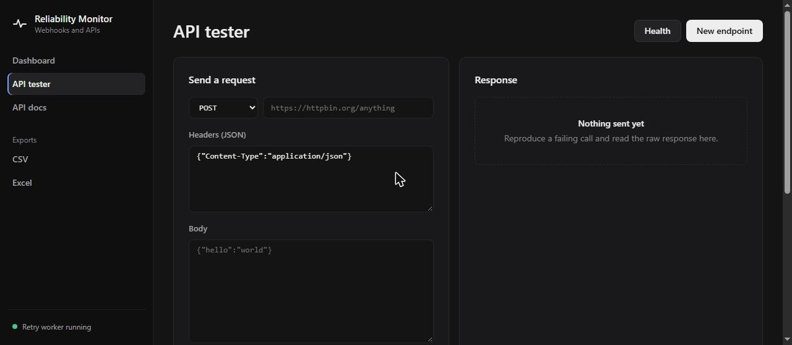

<div align="center">

# 📡 API & Webhook Reliability Monitor

**Receive webhooks, check them, forward them, retry the failures, and see at a glance what is going wrong.**

[](https://github.com/artyom129/api-webhook-reliability-monitor/actions/workflows/tests.yml)


**🌐 Language:** **English** · [Русский](README.ru.md) · [Қазақша](README.kk.md)



</div>

---

## 📌 Why this exists

Webhook integrations fail quietly: a sender posts invalid JSON, a secret expires, the receiving API has a bad five minutes, and nobody finds out until a customer asks where their order went. This project sits in the middle. It stores every request in full, tells you whether it was valid, forwards it to your API, retries when the API is down, and lets you replay any event later without asking the original service to send it again.

## ✨ What it does

| | Feature |
|---|---|
| 🔗 | **Receiver URLs.** Create an endpoint and get a `/hooks/{slug}` URL that accepts GET, POST, PUT, PATCH, and DELETE |
| 🗃️ | **Full capture.** Method, headers, query string, content type, raw body, and parsed JSON are stored for every request |
| ✅ | **Validation.** Checks that JSON bodies parse and that the `X-Webhook-Secret` header matches. Invalid requests are kept, flagged, and never forwarded |
| 🔐 | **Secret handling.** The shared secret is checked, then redacted. It is not stored with the event, shown in the UI, or sent to your target |
| ➡️ | **Forwarding.** Sends the original headers, query, and body to a target URL and records status, response, and duration for every attempt |
| 🔁 | **Retries with backoff.** A failed delivery is retried after a delay that doubles each time, until the endpoint's retry limit is used up |
| ▶️ | **Replay.** Re-send any stored event with one click, or queue an immediate retry |
| 📈 | **Dashboard.** Delivery rate, events needing attention, invalid requests, average response time, and an hourly chart for the last 24 hours |
| 🔎 | **Search API.** `/api/events` filters by endpoint, validation status, delivery status, and text in the body or error |
| 🧪 | **API tester.** Send any REST request from the browser and keep a history of the calls |
| 📥 | **Exports.** CSV and formatted Excel. Webhook bodies that start like a spreadsheet formula are neutralized |
| 🩺 | **Health check.** `/health` checks the database and reports whether the retry worker is running |
| 🌗 | **Light and dark.** The interface follows the system theme |

## 🔄 How a request travels



## 🖼️ Screens

| Endpoint | Event |
|---|---|
|  |  |



## 🚀 Quick start

```bash
git clone https://github.com/artyom129/api-webhook-reliability-monitor.git
cd api-webhook-reliability-monitor
python -m venv .venv
```

Activate the environment:

```bash
# Windows
.venv\Scripts\activate

# macOS / Linux
source .venv/bin/activate
```

Install the dependencies and start the server:

```bash
pip install -r requirements.txt
python run.py
```

Then open:

- Dashboard: http://localhost:8000
- API docs (Swagger): http://localhost:8000/docs
- Health check: http://localhost:8000/health

`run.py` listens on `127.0.0.1` only. To reach it from another device set `HOST=0.0.0.0`, and read the security notes first.

### Demo data

```bash
python seed_demo.py
python run.py
```

This creates three endpoints and about 80 events spread over the last day, including failures, invalid requests, and a scheduled retry. The script refuses to touch a database that already has data. Use `python seed_demo.py --reset` to replace it.

### Docker

```bash
docker compose up --build
```

The SQLite database lives in a Docker volume.

## 🧭 Example workflow

1. Create an endpoint called `Stripe Payments` (slug `stripe-payments`) with a target URL and a secret.
2. Send a request:

```bash
curl -X POST http://localhost:8000/hooks/stripe-payments \
  -H "Content-Type: application/json" \
  -H "X-Webhook-Secret: your-secret" \
  -d '{"type":"invoice.paid","data":{"id":"in_123"}}'
```

3. Open the event in the dashboard and check validation and delivery.
4. If your API was down, fix it and press **Replay now**.
5. Export the incident history as CSV or Excel.

## 🔁 Retries and delivery statuses

`max_retries` counts retries **after** the first attempt, so `3` means up to four attempts in total. The wait before each retry doubles. With a 30 second base delay the retries come after 30, 60, and 120 seconds.

| Status | Meaning |
|---|---|
| `not_configured` | The endpoint has no target URL or automatic forwarding is off |
| `queued` | Accepted and about to be forwarded |
| `skipped` | The request failed validation, so it was stored but not forwarded |
| `delivered` | The target answered with a 2xx status |
| `retry_scheduled` | The last attempt failed and another one is planned |
| `exhausted` | Every allowed retry failed |

A delivery is retried only when the endpoint is active, automatic forwarding is on, the request passed validation, and retries are left. Every attempt is stored for the audit trail.

## 🌐 Routes

| Route | Purpose |
|---|---|
| `/` | Dashboard |
| `/hooks/{slug}` | Public webhook receiver |
| `/endpoints/{id}` | Endpoint settings and captured requests |
| `/events/{id}` | Payload, headers, response, and delivery attempts |
| `/api-tester` | Manual REST request tester |
| `/api/stats` | Dashboard numbers as JSON |
| `/api/events` | Events as JSON. Filters: `endpoint`, `validation_status`, `forwarding_status`, `q`, `limit` |
| `/exports/events.csv`, `/exports/events.xlsx` | Event history exports |
| `/health` | Database and worker status (HTTP 503 if the database is unreachable) |
| `/docs` | Swagger documentation |

## ⚙️ Configuration

Set these in the environment (a template is in `.env.example`).

| Variable | Meaning | Default |
|---|---|---|
| `DATABASE_URL` | SQLAlchemy URL of the database | `sqlite:///./data/monitor.db` |
| `RETRY_POLL_SECONDS` | How often the worker looks for due retries | `5` |
| `REQUEST_TIMEOUT_SECONDS` | Timeout for forwarded requests and the API tester | `15` |
| `MAX_BODY_BYTES` | Larger webhook bodies are rejected with HTTP 413 | `1000000` |
| `APP_NAME` | Name shown in page titles | API & Webhook Reliability Monitor |
| `HOST`, `PORT`, `RELOAD` | Used by `run.py` only | `127.0.0.1`, `8000`, `1` |

<details>
<summary>🐛 Problems found and fixed in this version</summary>

<br>

- **`max_retries=1` never retried.** The limit was compared against the total number of attempts, so one retry meant zero. It now counts retries after the first attempt.
- **The shared secret was forwarded to the target.** Every header was copied, including `X-Webhook-Secret`, so the receiving service learned the monitor's own credential. It was also saved with the event and shown on the event page. It is now redacted before storing and never forwarded.
- **Formula injection in exports.** A webhook body such as `=HYPERLINK(...)` became a live formula when the Excel or CSV export was opened. Cells that start with `=`, `+`, `-`, or `@` are now written as text.
- **Invalid requests stayed `queued` forever.** They were marked as waiting to be forwarded but never forwarded. They are now marked `skipped`.
- **No limit on request size.** A single huge body went straight into the database. The default limit is 1 MB.
- **The sidebar always said "Retry worker active".** It now reflects the real state of the worker.
- **`/health` only returned a constant.** It now checks the database.
- **"Searchable" history had no search.** `/api/events` now filters by endpoint, status, and text. Text search treats `%` and `_` as ordinary characters.
- **`seed_demo.py` erased the database without asking**, and **`run.py` listened on every network interface with auto-reload on.** The seed script now asks for `--reset`, and the server binds to localhost by default.
- **The README referred to a missing `.env.example`.** The file exists now.
- **Test setup was slow on some disks.** Creating a SQLite file took about 2.5 seconds per test on Windows, which made the suite take almost two minutes. Tests use an in-memory database and finish in about 3 seconds.

</details>

## 🧪 Tests

```bash
python -m pytest
```

44 tests, no network. The HTTP client is replaced with a fake, so the tests check exactly what is sent to the target. They cover validation, secret handling, forwarding, the retry schedule, replay, pausing and rotating secrets, the API tester, filters and search, statistics, exports (including formula protection), error pages, and the hourly chart data. CI runs them on Python 3.11 and 3.12.

## 📂 Project structure

```text
app/
├── main.py          # routes and application factory
├── models.py        # SQLAlchemy models
├── services.py      # forwarding, retries, statistics, search
├── config.py        # environment settings
├── database.py      # engine and session helpers
├── templates/       # pages
└── static/          # CSS and JavaScript
tests/
docs/screenshots/
seed_demo.py         # demo data
run.py               # development server
Dockerfile
docker-compose.yml
```

## 🔒 Security notes

This is a portfolio project, built to run on your own machine or inside a private network. Before you expose it:

- The dashboard has **no login**. Put it behind authentication or a VPN.
- Secrets are stored in the database as plain text.
- Forwarding and the API tester call any URL you give them, including addresses inside your network.
- Add HTTPS, rate limiting, and a production database such as PostgreSQL.

## 🧰 Tech stack

Python · FastAPI · SQLAlchemy 2 · HTTPX · Jinja2 · SQLite · pandas · openpyxl · Uvicorn · pytest · Docker · GitHub Actions

---

<div align="center">

*Developed by [Artyom Koncha](https://github.com/artyom129). MIT license.*

</div>
