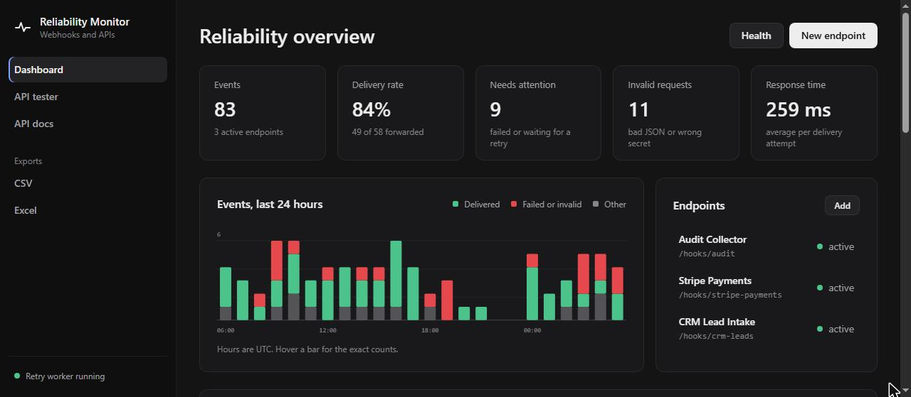
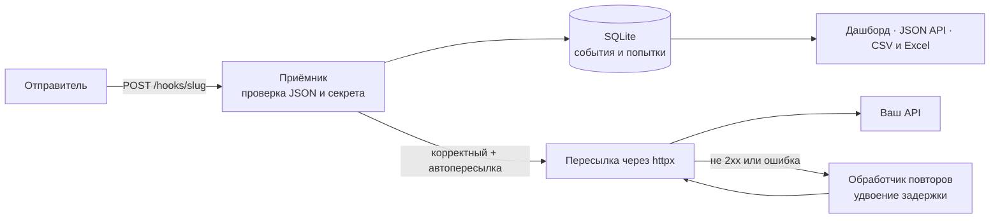
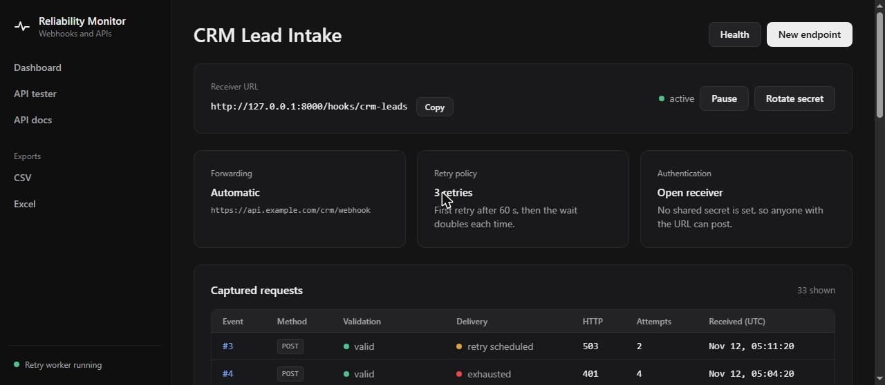
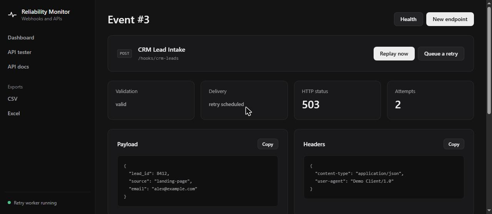
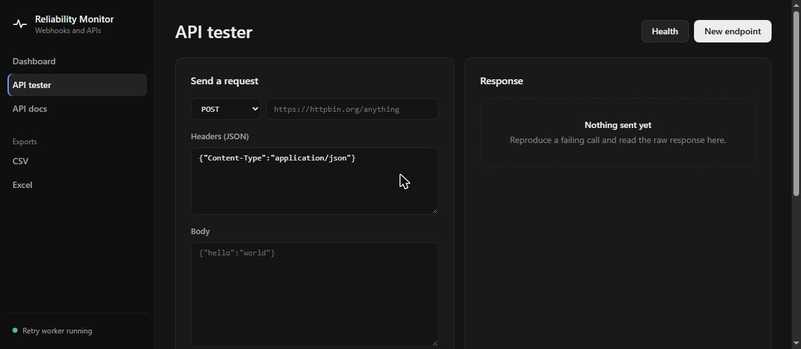

<div align="center">

# 📡 API & Webhook Reliability Monitor

**Принимает вебхуки, проверяет их, пересылает, повторяет неудачные доставки и сразу показывает, что идёт не так.**

[](https://github.com/artyom129/api-webhook-reliability-monitor/actions/workflows/tests.yml)


**🌐 Язык:** [English](README.md) · **Русский** · [Қазақша](README.kk.md)



</div>

---

## 📌 Зачем это нужно

Интеграции на вебхуках ломаются тихо: отправитель шлёт невалидный JSON, истекает секрет, у принимающего API случаются плохие пять минут, и никто не узнаёт об этом, пока клиент не спросит, где его заказ. Этот проект стоит посередине. Он сохраняет каждый запрос целиком, говорит, был ли он корректным, пересылает его в ваш API, повторяет доставку, когда API недоступен, и позволяет позже повторно отправить любое событие, не прося исходный сервис прислать его снова.

## ✨ Что он делает

| | Возможность |
|---|---|
| 🔗 | **Адреса-приёмники.** Создайте endpoint и получите URL `/hooks/{slug}`, который принимает GET, POST, PUT, PATCH и DELETE |
| 🗃️ | **Полное сохранение.** Для каждого запроса хранятся метод, заголовки, строка запроса, тип содержимого, исходное тело и разобранный JSON |
| ✅ | **Проверка.** Проверяет, что JSON-тело разбирается и что заголовок `X-Webhook-Secret` совпадает. Некорректные запросы сохраняются, помечаются и никогда не пересылаются |
| 🔐 | **Работа с секретом.** Общий секрет проверяется, а затем скрывается. Он не сохраняется вместе с событием, не показывается в интерфейсе и не отправляется на ваш целевой сервер |
| ➡️ | **Пересылка.** Отправляет исходные заголовки, параметры и тело на целевой URL и записывает статус, ответ и длительность каждой попытки |
| 🔁 | **Повторы с задержкой.** Неудачная доставка повторяется с задержкой, которая каждый раз удваивается, пока не исчерпан лимит endpoint |
| ▶️ | **Повторная отправка.** Отправьте любое сохранённое событие снова одним нажатием или поставьте немедленный повтор в очередь |
| 📈 | **Дашборд.** Доля доставленных, события, требующие внимания, некорректные запросы, среднее время ответа и график по часам за последние 24 часа |
| 🔎 | **API поиска.** `/api/events` фильтрует по endpoint, статусу проверки, статусу доставки и тексту в теле или ошибке |
| 🧪 | **Тестер API.** Отправляйте любые REST-запросы из браузера, история вызовов сохраняется |
| 📥 | **Экспорт.** CSV и отформатированный Excel. Тела вебхуков, которые начинаются как формула таблицы, обезвреживаются |
| 🩺 | **Проверка состояния.** `/health` проверяет базу данных и сообщает, работает ли обработчик повторов |
| 🌗 | **Светлая и тёмная тема.** Интерфейс следует системной теме |

## 🔄 Путь запроса



## 🖼️ Экраны

| Endpoint | Событие |
|---|---|
|  |  |



## 🚀 Быстрый старт

```bash
git clone https://github.com/artyom129/api-webhook-reliability-monitor.git
cd api-webhook-reliability-monitor
python -m venv .venv
```

Активируйте окружение:

```bash
# Windows
.venv\Scripts\activate

# macOS / Linux
source .venv/bin/activate
```

Установите зависимости и запустите сервер:

```bash
pip install -r requirements.txt
python run.py
```

Затем откройте:

- Дашборд: http://localhost:8000
- Документация API (Swagger): http://localhost:8000/docs
- Проверка состояния: http://localhost:8000/health

`run.py` слушает только `127.0.0.1`. Чтобы открыть доступ с другого устройства, задайте `HOST=0.0.0.0`, но сначала прочитайте раздел о безопасности.

### Демо-данные

```bash
python seed_demo.py
python run.py
```

Скрипт создаёт три endpoint и около 80 событий за последние сутки, включая сбои, некорректные запросы и запланированный повтор. Он отказывается менять базу, в которой уже есть данные. Чтобы заменить её, запустите `python seed_demo.py --reset`.

### Docker

```bash
docker compose up --build
```

База SQLite хранится в томе Docker.

## 🧭 Пример сценария

1. Создайте endpoint `Stripe Payments` (slug `stripe-payments`) с целевым URL и секретом.
2. Отправьте запрос:

```bash
curl -X POST http://localhost:8000/hooks/stripe-payments \
  -H "Content-Type: application/json" \
  -H "X-Webhook-Secret: your-secret" \
  -d '{"type":"invoice.paid","data":{"id":"in_123"}}'
```

3. Откройте событие на дашборде и проверьте статус проверки и доставки.
4. Если ваш API был недоступен, почините его и нажмите **Replay now**.
5. Выгрузите историю инцидентов в CSV или Excel.

## 🔁 Повторы и статусы доставки

`max_retries` считает повторы **после** первой попытки, поэтому `3` означает до четырёх попыток в сумме. Пауза перед каждым повтором удваивается. При базовой задержке 30 секунд повторы идут через 30, 60 и 120 секунд.

| Статус | Значение |
|---|---|
| `not_configured` | У endpoint нет целевого URL или автопересылка выключена |
| `queued` | Принято и вот-вот будет переслано |
| `skipped` | Запрос не прошёл проверку, поэтому он сохранён, но не переслан |
| `delivered` | Целевой сервер ответил статусом 2xx |
| `retry_scheduled` | Последняя попытка не удалась, запланирована следующая |
| `exhausted` | Все разрешённые повторы не удались |

Доставка повторяется, только если endpoint активен, автопересылка включена, запрос прошёл проверку и остались повторы. Каждая попытка сохраняется для журнала.

## 🌐 Маршруты

| Маршрут | Назначение |
|---|---|
| `/` | Дашборд |
| `/hooks/{slug}` | Публичный приёмник вебхуков |
| `/endpoints/{id}` | Настройки endpoint и сохранённые запросы |
| `/events/{id}` | Тело, заголовки, ответ и попытки доставки |
| `/api-tester` | Ручной тестер REST-запросов |
| `/api/stats` | Числа с дашборда в JSON |
| `/api/events` | События в JSON. Фильтры: `endpoint`, `validation_status`, `forwarding_status`, `q`, `limit` |
| `/exports/events.csv`, `/exports/events.xlsx` | Экспорт истории событий |
| `/health` | Состояние базы и обработчика (HTTP 503, если база недоступна) |
| `/docs` | Документация Swagger |

## ⚙️ Настройка

Задавайте переменные в окружении (шаблон лежит в `.env.example`).

| Переменная | Значение | По умолчанию |
|---|---|---|
| `DATABASE_URL` | URL базы данных SQLAlchemy | `sqlite:///./data/monitor.db` |
| `RETRY_POLL_SECONDS` | Как часто обработчик ищет наступившие повторы | `5` |
| `REQUEST_TIMEOUT_SECONDS` | Таймаут пересылаемых запросов и тестера API | `15` |
| `MAX_BODY_BYTES` | Более крупные тела вебхуков отклоняются с HTTP 413 | `1000000` |
| `APP_NAME` | Название в заголовках страниц | API & Webhook Reliability Monitor |
| `HOST`, `PORT`, `RELOAD` | Только для `run.py` | `127.0.0.1`, `8000`, `1` |

<details>
<summary>🐛 Проблемы, найденные и исправленные в этой версии</summary>

<br>

- **`max_retries=1` не делал повторов.** Лимит сравнивался с общим числом попыток, поэтому один повтор означал ноль. Теперь он считает повторы после первой попытки.
- **Общий секрет пересылался на целевой сервер.** Копировались все заголовки, включая `X-Webhook-Secret`, поэтому принимающий сервис узнавал учётные данные самого монитора. Секрет ещё и сохранялся вместе с событием и показывался на его странице. Теперь он скрывается перед сохранением и никогда не пересылается.
- **Инъекция формул в экспорте.** Тело вебхука вроде `=HYPERLINK(...)` превращалось в рабочую формулу при открытии Excel или CSV. Ячейки, начинающиеся с `=`, `+`, `-` или `@`, теперь записываются как текст.
- **Некорректные запросы навсегда оставались `queued`.** Они помечались как ожидающие пересылки, но не пересылались. Теперь им ставится `skipped`.
- **Не было ограничения размера запроса.** Один огромный запрос шёл прямо в базу. Лимит по умолчанию 1 МБ.
- **В боковой панели всегда было написано «Retry worker active».** Теперь показывается настоящее состояние обработчика.
- **`/health` возвращал константу.** Теперь он проверяет базу данных.
- **У «искомой» истории не было поиска.** `/api/events` теперь фильтрует по endpoint, статусу и тексту. Поиск по тексту считает `%` и `_` обычными символами.
- **`seed_demo.py` стирал базу без вопросов**, а **`run.py` слушал все сетевые интерфейсы с автоперезагрузкой.** Теперь скрипту нужен `--reset`, а сервер по умолчанию слушает только localhost.
- **README ссылался на несуществующий `.env.example`.** Теперь файл есть.
- **Подготовка тестов была медленной на некоторых дисках.** Создание файла SQLite занимало около 2,5 секунды на тест в Windows, и набор шёл почти две минуты. Теперь тесты используют базу в памяти и укладываются примерно в 3 секунды.

</details>

## 🧪 Тесты

```bash
python -m pytest
```

44 теста, без сети. HTTP-клиент заменён заглушкой, поэтому тесты проверяют ровно то, что уходит на целевой сервер. Они покрывают проверку запросов, работу с секретом, пересылку, расписание повторов, повторную отправку, паузу и смену секрета, тестер API, фильтры и поиск, статистику, экспорт (включая защиту от формул), страницы ошибок и данные для графика по часам. CI запускает их на Python 3.11 и 3.12.

## 📂 Структура проекта

```text
app/
├── main.py          # маршруты и фабрика приложения
├── models.py        # модели SQLAlchemy
├── services.py      # пересылка, повторы, статистика, поиск
├── config.py        # настройки из окружения
├── database.py      # движок и сессии
├── templates/       # страницы
└── static/          # CSS и JavaScript
tests/
docs/screenshots/
seed_demo.py         # демо-данные
run.py               # сервер для разработки
Dockerfile
docker-compose.yml
```

## 🔒 О безопасности

Это портфолио-проект, рассчитанный на запуск на вашем компьютере или внутри закрытой сети. Прежде чем открывать его наружу:

- У дашборда **нет входа по паролю**. Поставьте его за аутентификацию или VPN.
- Секреты хранятся в базе открытым текстом.
- Пересылка и тестер API обращаются по любому адресу, который вы укажете, включая адреса внутри вашей сети.
- Добавьте HTTPS, ограничение частоты запросов и промышленную базу данных, например PostgreSQL.

## 🧰 Технологии

Python · FastAPI · SQLAlchemy 2 · HTTPX · Jinja2 · SQLite · pandas · openpyxl · Uvicorn · pytest · Docker · GitHub Actions

---

<div align="center">

*Автор: [Artyom Koncha](https://github.com/artyom129). Лицензия MIT.*

</div>
